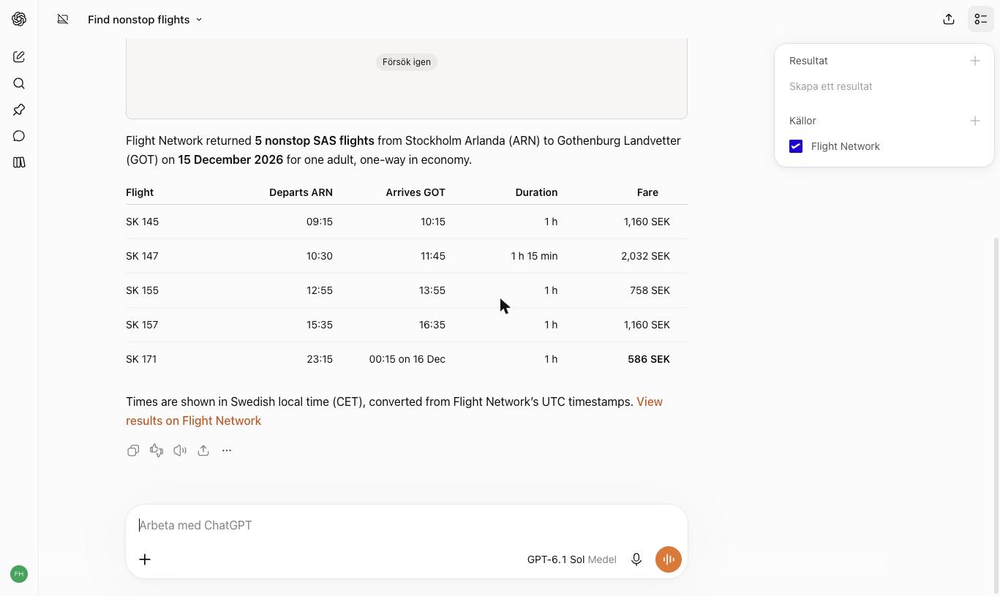

# Flight time check

A live test of the Flight Network app inside ChatGPT, checked against se.flightnetwork.com.

By Faris Sadik, 17 November 2026. An independent test of public pages, with no access to internal systems or data.

## The finding

Same flight, same fare, one hour apart.

| ChatGPT, Flight Network app | se.flightnetwork.com, opened from that answer |
|---|---|
|  |  |
| SK 171, 586 SEK: **23:15 → 00:15, 16 Dec** | Same flight, same fare: **22:15 → 23:15, 15 Dec** |

I ran 25 one-way flight searches for 15 December 2026 and opened the link each answer gives to the website.

| Outcome | Searches |
|---|---|
| The chat shows a different hour than the website | 6 |
| Right digits, but presented as UTC | 6 |
| Right, and the model says it overrode the UTC marker | 11 |
| Right, both airports at UTC+0 | 2 |

- Both airports in the same non-UTC time zone: 11 of 12 wrong or mislabelled.
- Airports in different time zones: 1 of 11.
- 100 of the 108 flights ChatGPT listed were matched to a row on the first website page.

The booking page shows the right time in every case. The exposure is a traveller who plans from the chat alone.

## The same search, ten more times

Stockholm to Gothenburg, repeated ten times in new chats (`data/repeat.json`): 8 showed 23:15 for the 22:15 flight, 1 was right, 1 ended in a ChatGPT error with no answer. From sending the question to a finished answer took a median of 43 seconds over the nine answers, range 39 to 88. The one right answer was the 88 second one: the model searched the web for the schedule before it trusted the tool.

## Cause, as far as it can be seen from outside

ChatGPT quoted the tool's fields in ten conversations, 17 flights (`data/quoted.json`). The value is local clock time with a `Z` suffix, and `Z` means UTC.


```
"dep": { "iata": "ZRH", "time": "2026-12-15T07:10:00Z" }
"arr": { "iata": "FCO", "time": "2026-12-15T08:40:00Z" }
"durationMinutes": 90
```

The website shows this flight leaving Zurich at 07:10 local time.

Why only some answers go wrong: the model checks the times against the duration. Across two time zones the numbers clash and the model trusts the duration. Inside one time zone nothing clashes, so the model believes the label.

I have not seen the tool's response directly, only ChatGPT's quote of it. MCP access is by application.

## The fix, and the test of it

Two rules, in `contract.py`:

1. Departure and arrival are the airport's local clock time and carry that airport's UTC offset.
2. Arrival minus departure equals `durationMinutes`.

```
"dep": { "iata": "ZRH", "time": "2026-12-15T07:10:00+01:00" }
```

A/B on the same consumer model (`data/ab.json`, screenshots in `screenshots/ab/`): three real flights pasted as a tool result into a new chat, Zurich to Rome five times per arm and London to Stockholm three times per arm.

| Format of the time field | Right local times |
|---|---|
| As returned today, with `Z` | 0 of 8 |
| With the airport's offset | 8 of 8 |
| Stopgap: `Z` kept, plus one sentence saying the times are local | 3 of 3, each with a remark that the `Z` conflicts |

The stopgap buys time. It does not remove the fault, and it does not help a client that parses the field with a date library.

In summer the gap is two hours. One extra search for 15 July 2027, Stockholm to Gothenburg: ChatGPT 23:55 → 00:55 next day, website 21:55 → 22:55.

| ChatGPT | Website |
|---|---|
|  |  |

## Run it

Python 3.9 or later, standard library only. `pytest` for the tests.

```
python3 -m pytest -q      # 9 tests
python3 replay.py         # 23 of 25 searches break a rule as returned today, 0 of 25 with the offset
```

`replay.py` rebuilds payloads from the website's times, so its 23 of 25 follows from the time zones. The direct evidence is the 17 quoted flights and the 16 A/B trials.

## Check it yourself in two minutes

1. Open ChatGPT with the Flight Network app added.
2. Ask for one-way flights from Stockholm Arlanda to Gothenburg on 15 December 2026.
3. Open the Flight Network link in the answer and compare the departure times.

The answer varies from run to run. Routes inside one time zone are where it fails.

## What is in the repository

| Path | What |
|---|---|
| `contract.py` | The two rules, and `to_contract()` which shows the change |
| `replay.py` | Runs the rules over the 25 logged searches |
| `test_contract.py` | 9 tests |
| `data/log.jsonl` | One line per search: ChatGPT rows, ChatGPT's own note, website rows |
| `data/results.json` | Classification per search, computed by the analysis script |
| `data/quoted.json` | The 17 flights whose fields ChatGPT quoted |
| `data/ab.json` | The nineteen A/B trials |
| `data/repeat.json` | Ten repeats of one search, with time to answer |
| `data/latency.json` | The "worked for" times read off ChatGPT |
| `data/replay.json` | Output of `replay.py` |
| `screenshots/searches/` | ChatGPT and website for each search, `rNN_chat.jpg` and `rNN_web.jpg` |
| `screenshots/ab/` | The A/B trials: A and C with `Z`, B and D with the offset, E the stopgap |
| `report/Flight_time_check.html` | The full report as one page. Download it and open it in a browser |

## Limits

- One day, one account, one model setting (GPT-6.1 Sol, Medium), one market, one travel date.
- Searches 1 to 22 were planned in advance: 7 of 20 valid ones were wrong. Searches 23 to 27 were chosen after the first 22, to test the same-zone explanation: 5 of 5 wrong. The 12 of 25 total includes them. Searches 9 and 16 returned no nonstop flights and are kept in the log as void.
- The answer changes between runs. A newer model may repair more or fewer.
- The A/B pasted the payload as text. It was not delivered through the app, and it covers two routes.
- Fares: in 14 of 100 matched flights the fare in the chat differs from the matched website row by 2 to 31 SEK. Matching is by time and duration, not flight number, so this is an observation, not a finding.
- Nobody was booked on a wrong flight in this test.

## Licence

Code under the MIT licence, see `LICENSE`. Screenshots are captures of public pages, taken in my own browser, and are included as evidence.
