# The searches

Every search from 17 November 2026: what the website showed, what ChatGPT showed, and both screens.
Generated by `gallery.py` from `data/results.json`.

## 1. ARN to LGW: Wrong hour

| | Departs | Arrives |
|---|---|---|
| Website, D8 4451 | 07:00 | 08:35 |
| ChatGPT | 08:00 | 08:35 |

ChatGPT's own note: "Times are local to each airport."

| ChatGPT | se.flightnetwork.com |
|---|---|
| 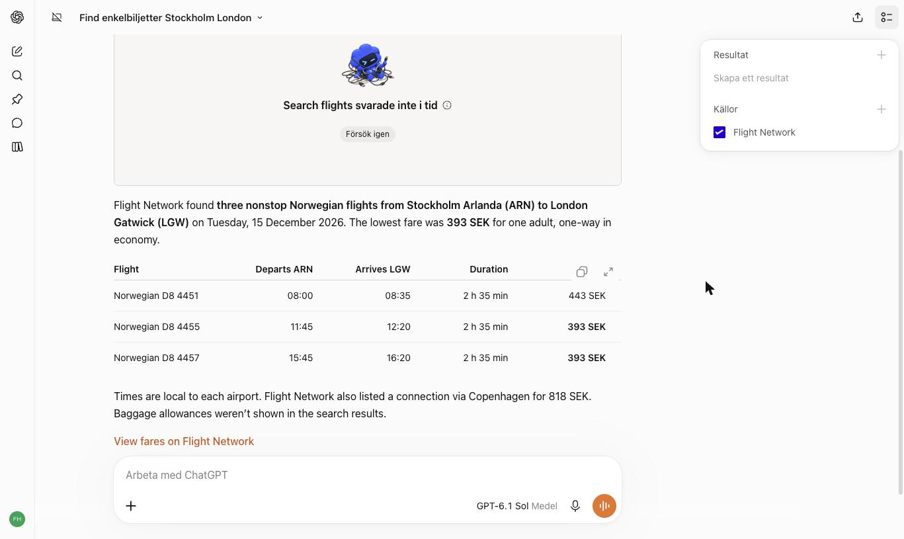 | 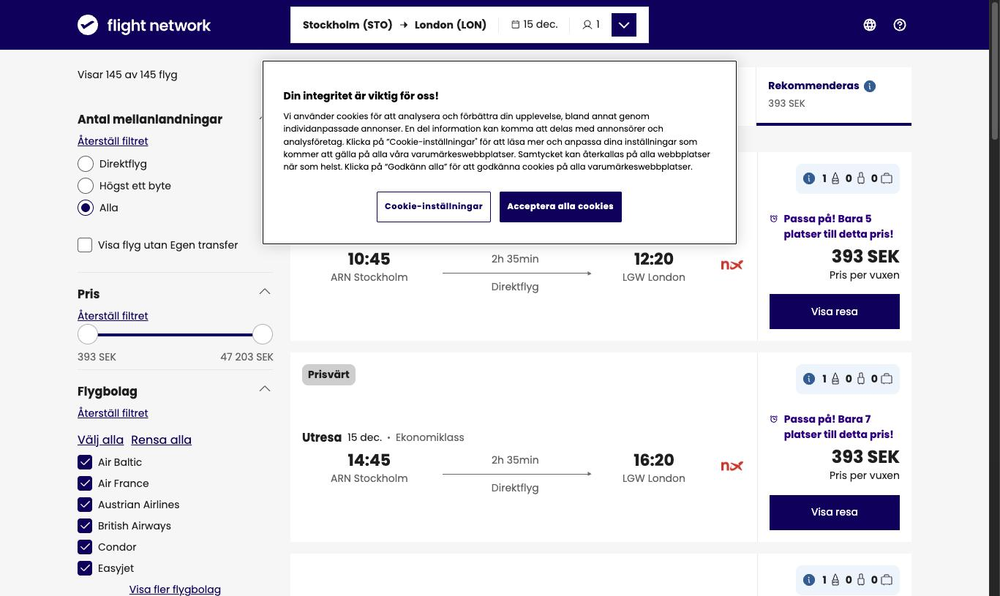 |

## 2. ARN to CPH: Wrong hour

| | Departs | Arrives |
|---|---|---|
| Website, D8 4151 | 07:00 | 08:10 |
| ChatGPT | 08:00 | 09:10 |

ChatGPT's own note: "Times are shown in local time (CET), converted from the UTC timestamps returned by Flight Network."

| ChatGPT | se.flightnetwork.com |
|---|---|
| 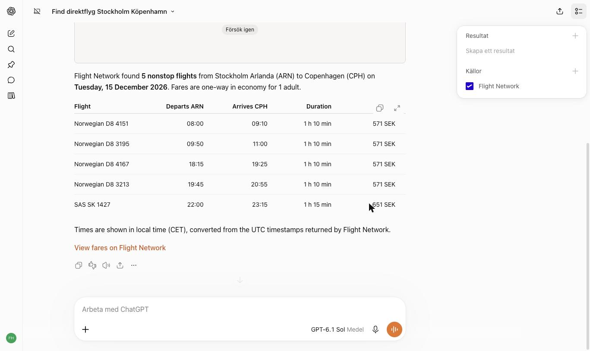 |  |

## 3. ARN to HEL: Right, model corrected it

| | Departs | Arrives |
|---|---|---|
| Website, AY 826 | 06:35 | 08:35 |
| ChatGPT | 06:35 | 08:35 |

ChatGPT's own note: "I've shown the clock times as returned. Flight Network marks both time fields as UTC, but the two-hour difference matches its listed one-hour duration if the times are local, with Helsinki one hour ahead of Stockholm."

| ChatGPT | se.flightnetwork.com |
|---|---|
| 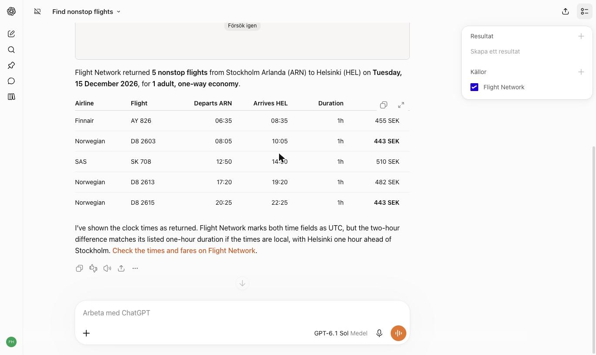 |  |

## 4. LHR to EDI: Right, unaffected

| | Departs | Arrives |
|---|---|---|
| Website, BA 1442 | 08:40 | 10:10 |
| ChatGPT | 08:40 | 10:10 |

ChatGPT's own note: "Times are local to the UK (GMT)."

| ChatGPT | se.flightnetwork.com |
|---|---|
| 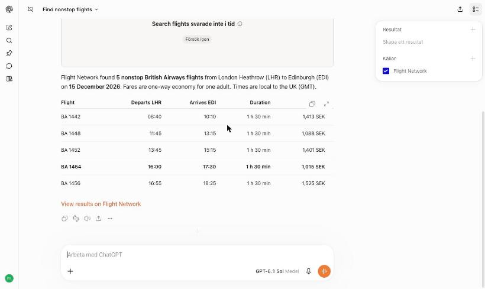 |  |

## 5. LIS to LHR: Right, unaffected

| | Departs | Arrives |
|---|---|---|
| Website, BA 513 | 07:05 | 10:05 |
| ChatGPT | 07:05 | 10:05 |

ChatGPT's own note: "All times are local (UTC+0 at both airports)."

| ChatGPT | se.flightnetwork.com |
|---|---|
| 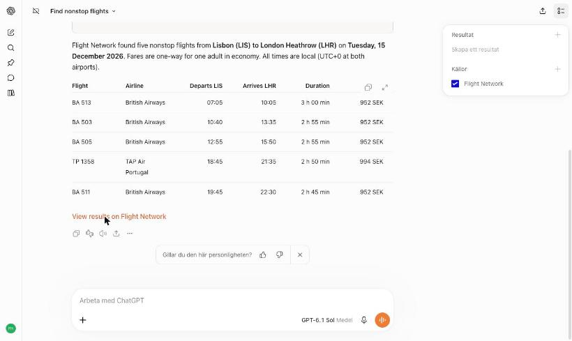 | 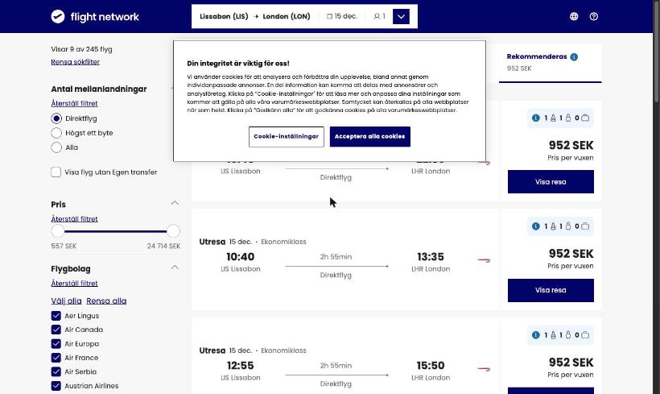 |

## 6. LHR to ARN: Right, model corrected it

| | Departs | Arrives |
|---|---|---|
| Website, SK 1530 | 06:40 | 10:05 |
| ChatGPT | 06:40 | 10:05 |

ChatGPT's own note: "Flight Network tagged both timestamps as UTC. I've shown the clock times as local because all five listed durations reconcile when Stockholm is one hour ahead of London."

| ChatGPT |
|---|
| 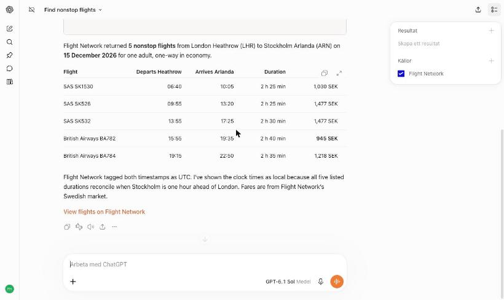 |

## 7. CDG to MAD: Wrong hour

| | Departs | Arrives |
|---|---|---|
| Website, IB 592 | 06:50 | 09:05 |
| ChatGPT | 07:50 | 10:05 |

ChatGPT's own note: "All times are local (CET)."

| ChatGPT |
|---|
| 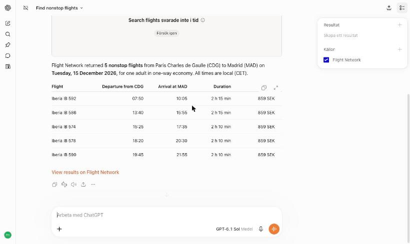 |

## 8. AMS to BCN: Right digits, shown as UTC

| | Departs | Arrives |
|---|---|---|
| Website, HV 5131 | 07:00 | 09:15 |
| ChatGPT | 07:00 | 09:15 |

ChatGPT's own note: "Column headers: Departure (UTC), Arrival (UTC). The table uses the UTC time labels returned by Flight Network and fares for the Swedish market."

| ChatGPT | se.flightnetwork.com |
|---|---|
| 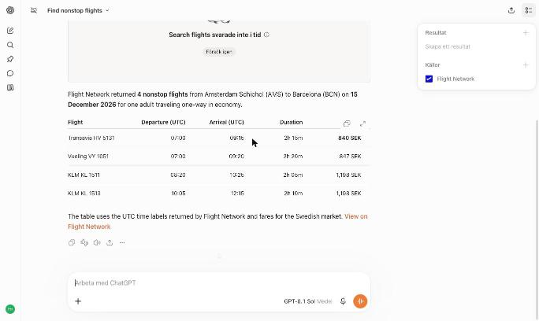 | 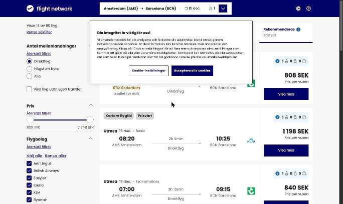 |

## 9. FRA to IST: No nonstop flights

ChatGPT's own note: "Flight Network returned no nonstop flights to IST, all five nonstop offers land at SAW. No times to compare."

| ChatGPT |
|---|
| 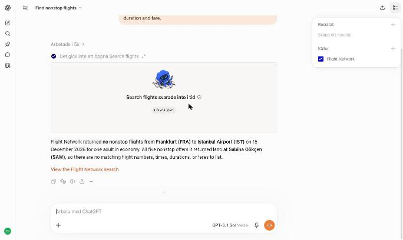 |

## 10. HEL to ARN: Right, model corrected it

| | Departs | Arrives |
|---|---|---|
| Website, D8 2602 | 07:20 | 07:30 |
| ChatGPT | 07:20 | 07:30 |

ChatGPT's own note: "I've displayed the clock times as local to each airport. Flight Network tags both time fields as UTC, but the listed durations reconcile when the times are read locally, with Helsinki one hour ahead of Stockholm."

| ChatGPT | se.flightnetwork.com |
|---|---|
| 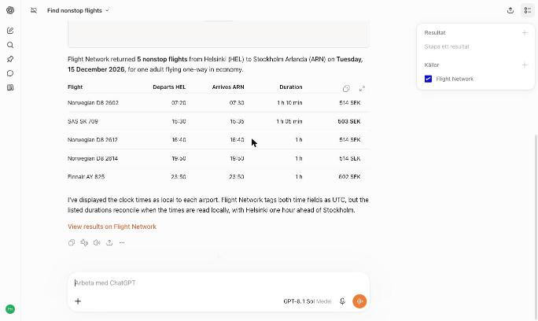 | 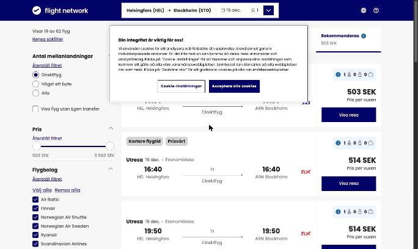 |

## 11. ATH to FCO: Right, model corrected it

| | Departs | Arrives |
|---|---|---|
| Website, A3 650 | 08:35 | 09:40 |
| ChatGPT | 08:35 | 09:40 |

ChatGPT's own note: "Times are local to each airport. Flight Network's raw timestamps carried a Z marker, but the published schedules and flight durations support reading the clock times as local. (ChatGPT ran a web search to check.)"

| ChatGPT | se.flightnetwork.com |
|---|---|
| 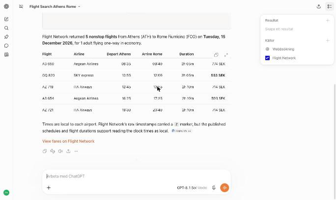 | 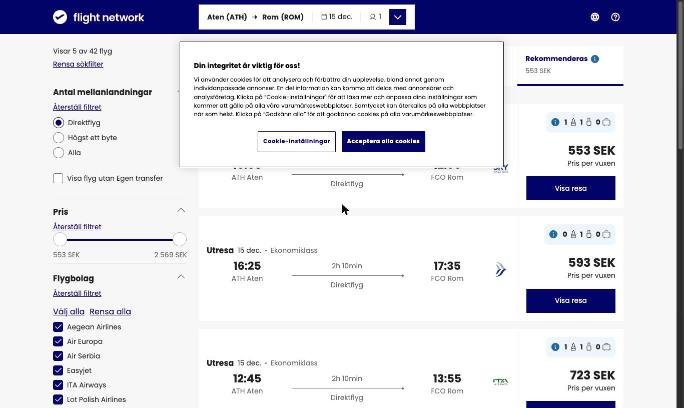 |

## 12. OSL to CPH: Wrong hour

| | Departs | Arrives |
|---|---|---|
| Website, DY 932 | 07:30 | 08:45 |
| ChatGPT | 08:30 | 09:45 |

ChatGPT's own note: "Fares are one-way for one adult, and times are local (CET)."

| ChatGPT | se.flightnetwork.com |
|---|---|
| 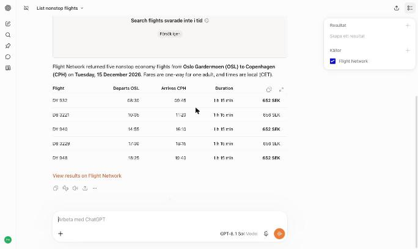 | 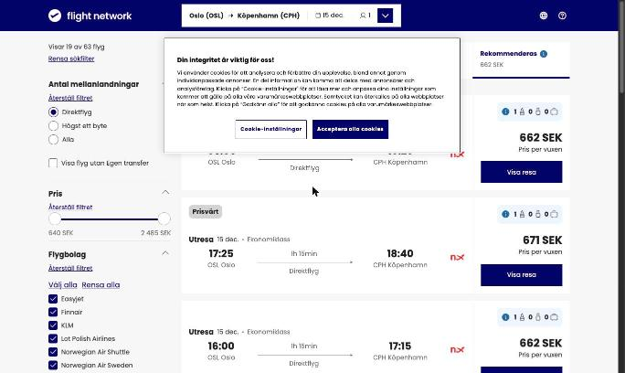 |

## 13. GOT to AMS: Right digits, shown as UTC

| | Departs | Arrives |
|---|---|---|
| Website, KL 1228 | 06:00 | 07:35 |
| ChatGPT | 06:00 | 07:35 |

ChatGPT's own note: "The table shows the times as returned by Flight Network, which marks them Z (UTC)."

| ChatGPT | se.flightnetwork.com |
|---|---|
| 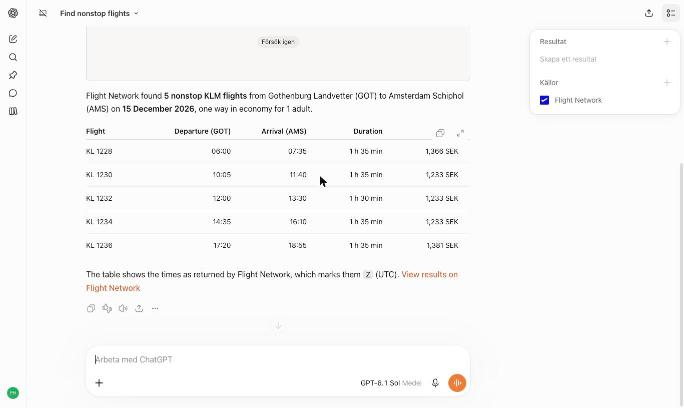 | 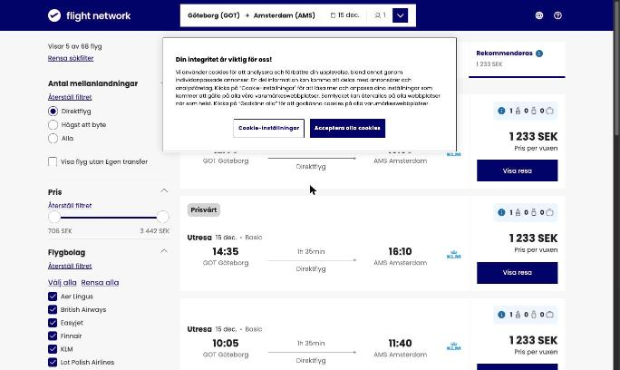 |

## 14. MUC to LHR: Right, model corrected it

| | Departs | Arrives |
|---|---|---|
| Website, LH 2472 | 09:25 | 10:25 |
| ChatGPT | 09:25 | 10:25 |

ChatGPT's own note: "Time zone discrepancy: Flight Network marks both times as UTC, which gives a one-hour interval. The reported two-hour duration matches the displayed times if departure is Munich local time and arrival is London local time. I've kept the times as returned."

| ChatGPT | se.flightnetwork.com |
|---|---|
| 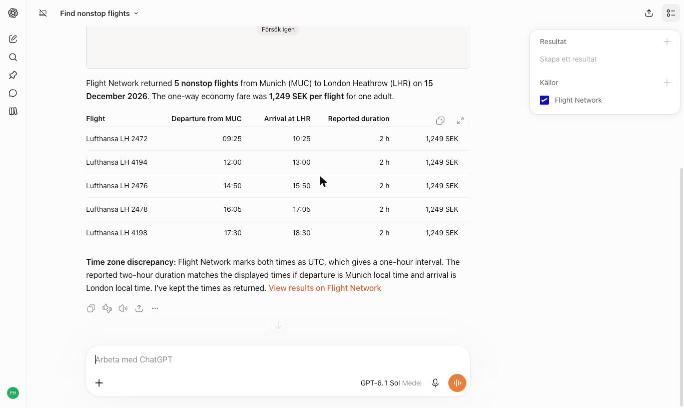 |  |

## 15. LHR to JFK: Right, model corrected it

| | Departs | Arrives |
|---|---|---|
| Website, BA 175 | 09:35 | 12:35 |
| ChatGPT | 09:35 | 12:35 |

ChatGPT's own note: "I've shown the clock times as returned. Flight Network appended a Z (UTC marker) to both time fields, but the durations it returned match those clock times when read as local to each airport."

| ChatGPT |
|---|
| 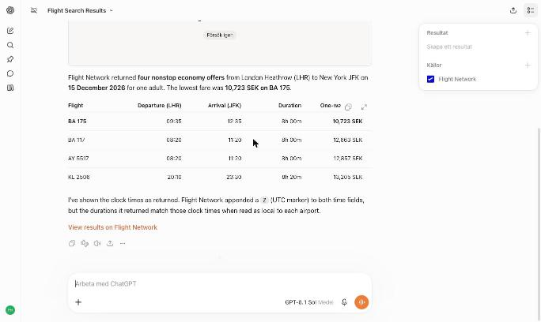 |

## 16. JFK to LAX: No nonstop flights

ChatGPT's own note: "Flight Network returned no matching nonstop flights. No times to compare."

## 17. JFK to LHR: Right, model corrected it

| | Departs | Arrives |
|---|---|---|
| Website, KL 2505 | 08:00 | 20:10 |
| ChatGPT | 08:00 | 20:10 |

ChatGPT's own note: "Flight Network marks the timestamps with Z, but the clock times match the listed durations when read as local airport times. I've shown them on that basis."

| ChatGPT | se.flightnetwork.com |
|---|---|
| 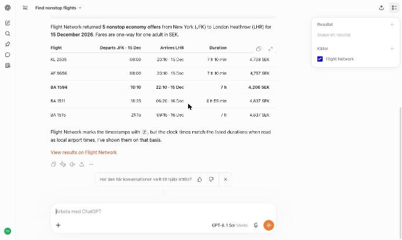 |  |

## 18. DXB to LHR: Right, model corrected it

| | Departs | Arrives |
|---|---|---|
| Website, EK 7 | 03:10 | 07:10 |
| ChatGPT | 03:10 | 07:10 |

ChatGPT's own note: "I've shown the times as airport-local. Flight Network's timestamps carry a Z suffix, but the reported durations match the displayed clock times when read as Dubai and London local times."

| ChatGPT | se.flightnetwork.com |
|---|---|
| 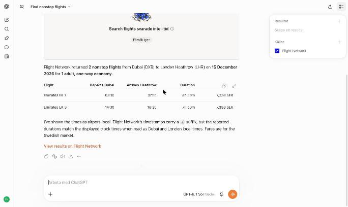 |  |

## 19. DEL to DXB: Right, model corrected it

| | Departs | Arrives |
|---|---|---|
| Website, 6E 1461 | 07:40 | 10:25 |
| ChatGPT | 07:40 | 10:25 |

ChatGPT's own note: "Flight Network marked the times as UTC, but the listed durations match when the displayed times are read as local to each airport. The table uses that interpretation."

| ChatGPT | se.flightnetwork.com |
|---|---|
| 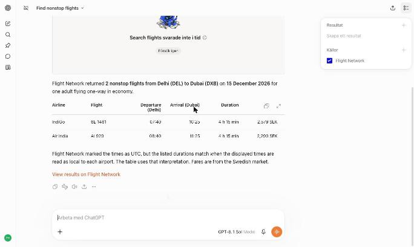 | 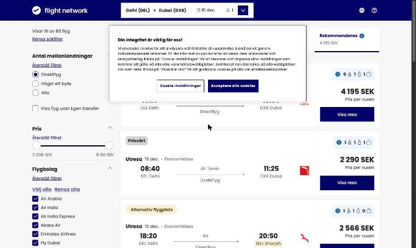 |

## 20. SIN to BKK: Right, model corrected it

| | Departs | Arrives |
|---|---|---|
| Website, TR 610 | 16:00 | 17:35 |
| ChatGPT | 16:00 | 17:35 |

ChatGPT's own note: "I've shown the times as local because that interpretation matches the listed duration and the one-hour time difference, even though Flight Network's timestamps carried a UTC marker. The other four results arrived at Bangkok Don Mueang (DMK)."

| ChatGPT | se.flightnetwork.com |
|---|---|
| 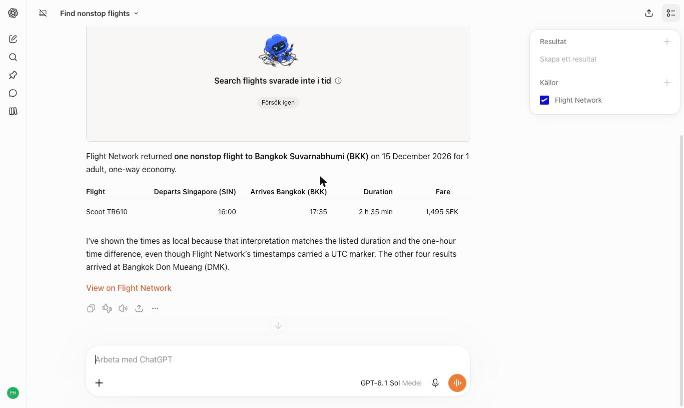 | 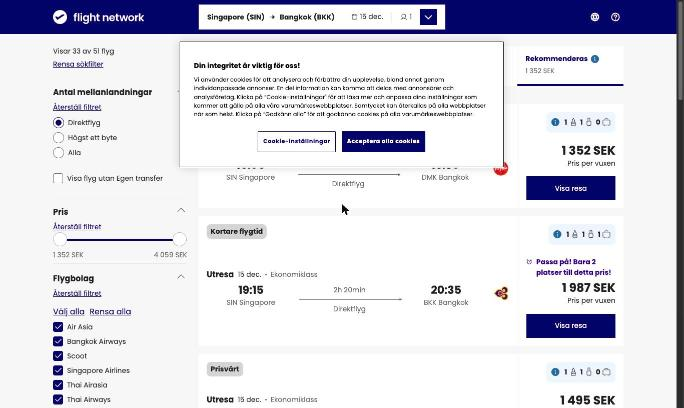 |

## 21. NRT to ICN: Right, model corrected it

| | Departs | Arrives |
|---|---|---|
| Website, RS 260 | 12:50 | 15:35 |
| ChatGPT | 12:50 | 15:35 |

ChatGPT's own note: "Times are local at both airports (UTC+9). Flight Network tagged the timestamps Z, but the clock times match published local schedules, so I used the displayed hours. (ChatGPT ran a web search to check.)"

| ChatGPT | se.flightnetwork.com |
|---|---|
| 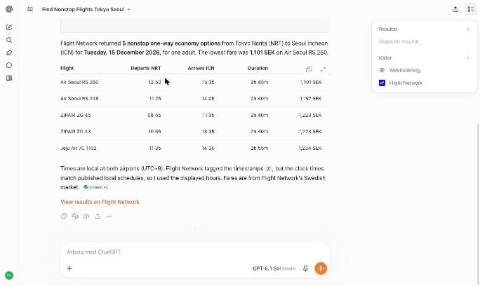 | 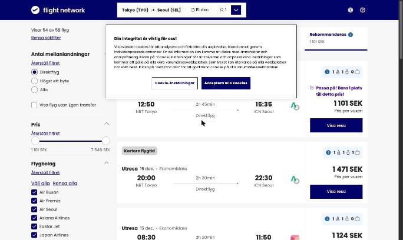 |

## 22. SYD to MEL: Right digits, shown as UTC

| | Departs | Arrives |
|---|---|---|
| Website, JQ 501 | 06:00 | 07:35 |
| ChatGPT | 06:00 | 07:35 |

ChatGPT's own note: "The table uses the clock times exactly as returned. Flight Network tagged both times with Z (UTC). Local departure and arrival times are unverified."

| ChatGPT | se.flightnetwork.com |
|---|---|
| 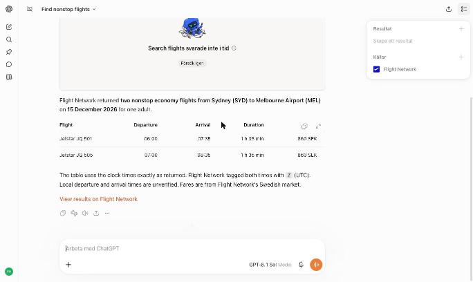 | 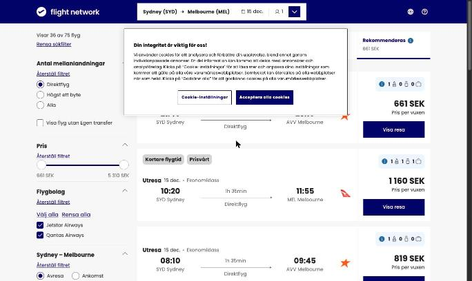 |

## 23. MAD to BCN: Right digits, shown as UTC

| | Departs | Arrives |
|---|---|---|
| Website, V7 3729 | 08:30 | 09:50 |
| ChatGPT | 08:30 | 09:50 |

ChatGPT's own note: "Column headers: Departure (UTC), Arrival (UTC). Times are shown as returned by Flight Network, which marked them Z (UTC)."

| ChatGPT | se.flightnetwork.com |
|---|---|
| 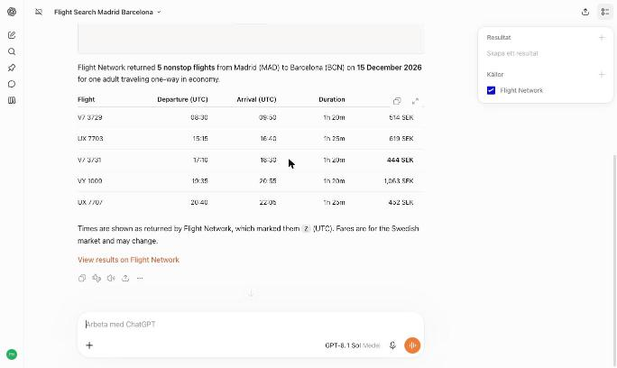 | 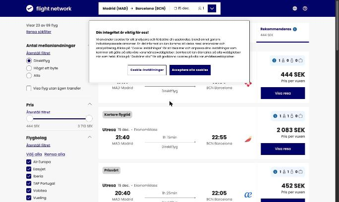 |

## 24. ARN to GOT: Wrong hour

| | Departs | Arrives |
|---|---|---|
| Website, SK 145 | 08:15 | 09:15 |
| ChatGPT | 09:15 | 10:15 |

ChatGPT's own note: "Times are shown in Swedish local time (CET), converted from Flight Network's UTC timestamps."

| ChatGPT | se.flightnetwork.com |
|---|---|
| 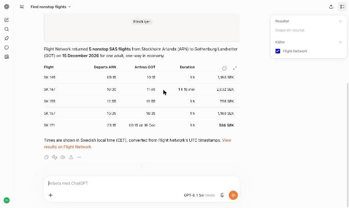 | 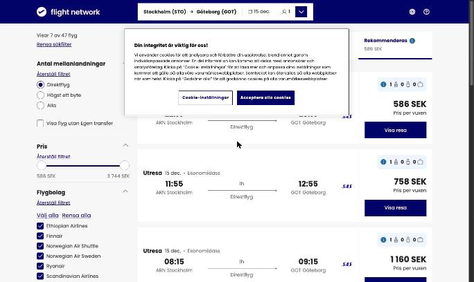 |

## 25. CPH to AMS: Wrong hour

| | Departs | Arrives |
|---|---|---|
| Website, KL 1270 | 12:05 | 13:30 |
| ChatGPT | 13:05 | 14:30 |

ChatGPT's own note: "Times are shown in local time (CET, UTC+1), converted from Flight Network's UTC timestamps."

| ChatGPT | se.flightnetwork.com |
|---|---|
| 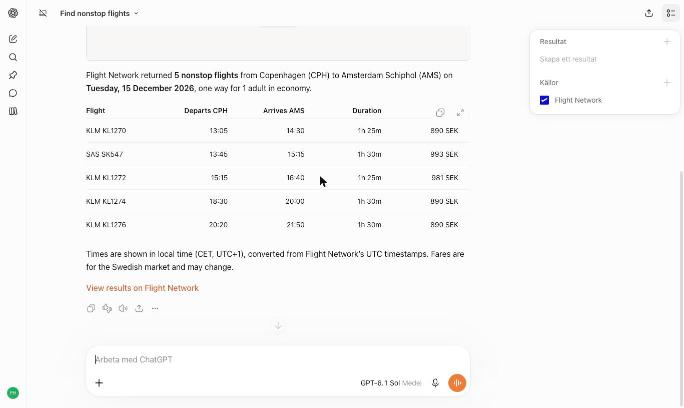 | 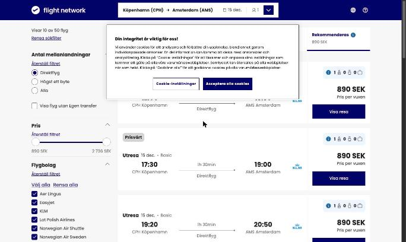 |

## 26. FRA to VIE: Right digits, shown as UTC

| | Departs | Arrives |
|---|---|---|
| Website, OS 222 | 06:50 | 08:15 |
| ChatGPT | 06:50 | 08:15 |

ChatGPT's own note: "Column headers: Departs FRA (UTC), Arrives VIE (UTC). Times are shown in UTC as returned by Flight Network. Frankfurt and Vienna are both one hour ahead of UTC on this date."

| ChatGPT | se.flightnetwork.com |
|---|---|
| 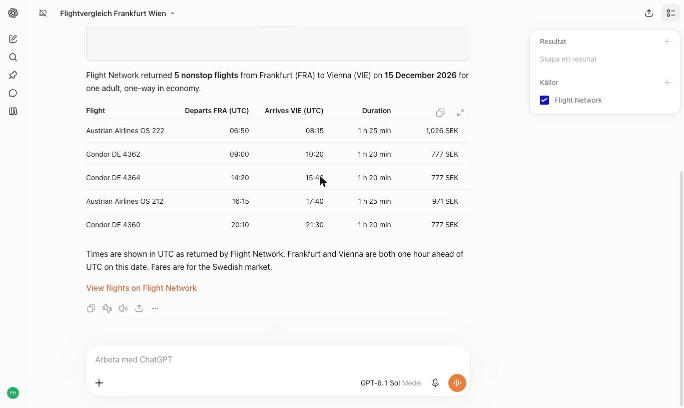 |  |

## 27. ZRH to FCO: Right digits, shown as UTC

| | Departs | Arrives |
|---|---|---|
| Website, LX 1726 | 07:10 | 08:40 |
| ChatGPT | 07:10 | 08:40 |

ChatGPT's own note: "Column headers: Departure (UTC), Arrival (UTC). Times are shown in UTC, as returned by Flight Network."

| ChatGPT | se.flightnetwork.com |
|---|---|
| 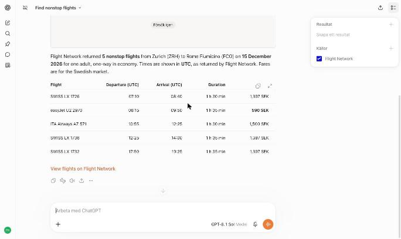 | 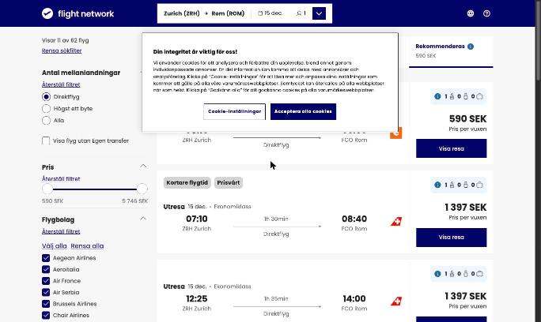 |
